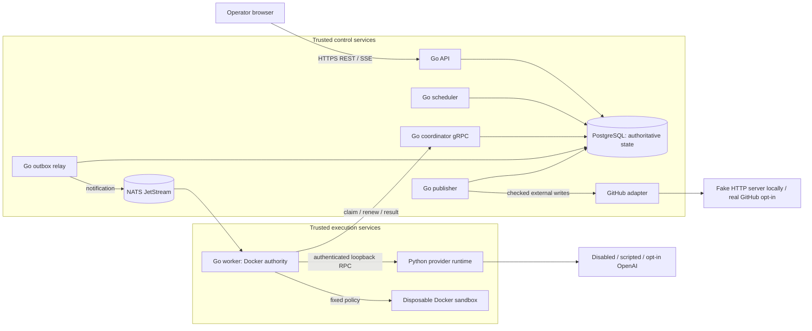
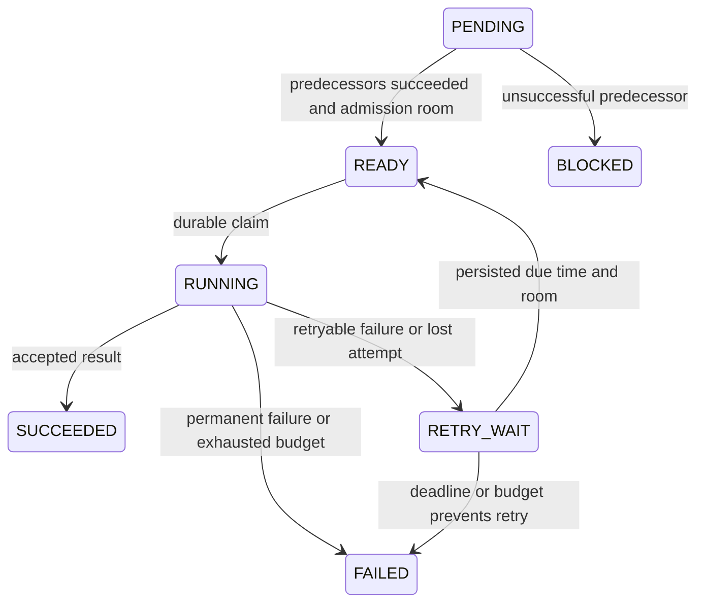

# ForgeSwarm engineering notes

## Purpose and reviewed scope

ForgeSwarm is a small, single-owner platform for coordinating bounded coding work. It persists dependency graphs, distributes work to authenticated workers, constrains tools and execution, retains candidate/test evidence, and can request approval for an exact draft pull request. Its intended audience is an operator studying or running controlled automation, rather than a public service accepting arbitrary repositories.

A concrete example is repairing `Add`, `Double`, and `Score` in a vetted, dependency-free Go fixture. Input identifies an immutable repository snapshot and base commit, plus a task description. Output is an integrated candidate, a patch, protected test evidence, a read-only review, and, for an imported GitHub issue, a durable publication approval. The recorded demonstration uses a **scripted TEST/DEMO provider and a fake GitHub HTTP server**, with real PostgreSQL, JetStream, Go/Python RPC, and Docker execution. It demonstrates infrastructure behavior, not measured model intelligence.

This repository-grounded review examines revision **`106fa68747e87e0ce01a2e02184f03011e278084`**. The working tree was clean before these two knowledge files were added. Review date: **2026-10-31, Asia/Calcutta**. Retained final-gate evidence is dated **2026-10-29 UTC**. No human review is claimed. No application code was changed for this documentation task.

The freshly recomputed source/configuration SHA-256 is:

```text
499f3d60916044769221a15876fdded79eec2f2afa31275bc74557331c738d7c
```

[scripts/dev.py](scripts/dev.py), `fingerprint`, hashes explicit root inputs and application, test, configuration, deployment, and script directories. It excludes generated/cache directories; root knowledge files and progress/evidence are outside its input set. Earlier evidence records the pre-commit revision `d568314` with a dirty tree. The matching content fingerprint, rather than that earlier Git identifier alone, binds those tests to the implementation reviewed here.

The local gate completed through `verify-all` followed by source/evidence-checked `verify-resume`, not one uninterrupted successful command. During this review, all **1,164 checkpoint evidence-file references** matched their recorded hashes. This detects alteration relative to those local records; it is not independent certification or proof of current service health. Ignored artifacts are available in this workspace and may be absent from a fresh clone.

Navigation starts at [progress.json](.forgeswarm/progress.json), the [final result index](artifacts/verification/stage-10/results.json), and [hashed prior-gate checkpoints](artifacts/verification/stage-10/prior-gate-checkpoints.json). Their completion labels were cross-checked against implementation, tests, and raw results, rather than accepted alone as proof.

Important unresolved limits appear early because they affect the whole account: paid provider behavior and real project PR publication remain unverified; AWS is configuration-tested only; two diagnostic attempts retain stop uncertainty; two load points missed their p95 goal. Containers share the host kernel, and trusted workers hold Docker authority. These facts prevent a general hostile-code or production-readiness claim.

## Architecture, ownership, and directories



PostgreSQL owns business state. The broker owns delivery state, not task completion. A worker owns transient execution only while database predicates authorize its attempt. The Python process generates structured proposals; it does not operate tools. Local runtime/worker pairs share a network namespace for authenticated loopback RPC. The sandbox has no network, credentials, or host source mounts. These are separate process and trust boundaries even when Compose runs them on one host.

Telemetry flows from trusted services to an OpenTelemetry Collector, then Prometheus/Grafana for metrics and Jaeger for traces. It is an observation path: losing the Collector must not change ownership or lifecycle decisions.

| Component | Real locations and useful entry symbols |
| --- | --- |
| Processes and configuration | [cmd/api/main.go](cmd/api/main.go), `run`; `cmd/{scheduler,coordinator,relay,worker,publisher}/main.go`; [internal/config](internal/config) |
| HTTP/domain | [internal/httpapi/api.go](internal/httpapi/api.go), `Handler`; [internal/workflow/workflow.go](internal/workflow/workflow.go), `Normalize`, `HashForVersion`; [graph.go](internal/workflow/graph.go), `ValidateGraph`, `Reconcile` |
| Durable coordination | [internal/postgres](internal/postgres), `Create`, `ReconcileBatch`, `ClaimTask`, `RenewLease`, `finishAttempt`; [migrations](migrations) |
| Transport/execution | [internal/broker/jetstream.go](internal/broker/jetstream.go), `Open`; [internal/relay/relay.go](internal/relay/relay.go), `Step`; [internal/worker/worker.go](internal/worker/worker.go), `handle`; [worker.proto](api/worker/v1/worker.proto) |
| Workspaces and tools | [internal/sandbox](internal/sandbox), `RegisterGit`, `RunSnapshot`; [internal/agent](internal/agent), `Run`, `RunRole`, `MergeSnapshot` |
| Provider boundary | [agent.proto](api/agent/v1/agent.proto), `Runtime`; [server.py](agent-runtime/forge_agent/server.py), `Runtime`; [provider.py](agent-runtime/forge_agent/provider.py), `OpenAI`, `ScriptedDemo` |
| Collaboration/publication | [collaboration.go](internal/postgres/collaboration.go), `FinalizePlan`, `PrepareRole`; [approvals.go](internal/postgres/approvals.go), `bindingTx`; [publisher.go](internal/postgres/publisher.go), `PublishOne`; [publish.go](internal/github/publish.go), `Publish` |
| Dashboard/observation | [web/src/App.tsx](web/src/App.tsx), [Approvals.tsx](web/src/Approvals.tsx), [internal/telemetry](internal/telemetry), [definitions.json](config/observability/definitions.json) |
| Experiments/operations | [internal/evaluation/engine.go](internal/evaluation/engine.go), `Engine.Run`; [scripts/performance.py](scripts/performance.py); [config/local/compose.json](config/local/compose.json); [deploy/aws](deploy/aws); [scripts/stage10.py](scripts/stage10.py) |

## Capability and evidence coverage

“Locally verified” below means real local tests retained for the matching source, supplemented by the fresh scoped checks described later. It does not imply a new full integration run during this documentation review.

| Capability | Classification and evidence | Boundary or gap |
| --- | --- | --- |
| Creation, idempotency, history, migration compatibility | Implemented and locally verified: workflow integration tests, final gates | One owner's database; bounded inputs |
| DAG, outbox, broker, authenticated claims and fencing | Implemented and locally verified with actual PostgreSQL/NATS/RPC | Single-replica broker; no exactly-once physical execution |
| Recovery, deadlines, admission, cancellation | Implemented and locally verified: recovery tests and fault matrix | Logical settlement can precede proof of physical stop |
| Docker execution and accepted artifacts | Implemented and locally verified with real Docker | Vetted fixtures; shared kernel and privileged trusted gateway |
| Coding tools, roles, integration, review | Implemented and locally verified; model decisions tested with scripted fixtures | Narrow pure-function profiles; no general repository agent claim |
| OpenAI adapter | Implemented; tested only through fixture/fake provider responses | Paid API behavior, account access, quality, and cost unverified |
| Approval and GitHub reconciliation | Implemented; tested with real local HTTP against a fake external adapter | No actual project draft PR verified |
| Dashboard, authentication, metrics and traces | Implemented and locally verified: components, recorded browser/transport/telemetry tests | Process-local sessions; bounded telemetry; browser private CA setup |
| Equal-budget evaluation | Implemented and locally verified as scripted plumbing | Real-model comparison missing |
| Performance/soak/restore | Implemented and locally measured, raw evidence retained | Small single-host samples; p95 and total cleanup goals partly unmet |
| Private AWS templates/bootstrap | Implemented but actual deployment currently unverified; offline validators passed | Account IAM, AMI, networking, EFS, and cloud restore untested |
| Production HA, multi-tenant authorization, arbitrary-code isolation | Planned/missing; excluded from built claims | Require architectural work and new validation |
| “Agents improve success,” “all performance goals passed,” “production-ready” | Unsupported or contradicted by evidence | Do not use as project claims |

Actual local integrations are distinguished from simulated external systems throughout. No live provider, GitHub publication, or AWS integration verification is established by the retained product evidence. Pushing this repository to GitHub is separate from testing its publication adapter.

## One actual execution, with commit boundaries

A workflow is a persisted graph. A task is one logical node. An attempt is a particular owned execution of that node. A notification merely points at a task/generation. An agent turn is one bounded proposal cycle inside an attempt. Multiple turns can belong to one attempt; a retry creates a different attempt for the same task.

There are several entrances. `POST /v1/workflows` accepts explicit diagnostic/sandbox task definitions. `POST /v1/jobs` accepts a registered coding job. `POST /v1/projects` starts controlled collaboration. `POST /v1/github/import` or a verified webhook prepares an allowlisted issue/repository and starts that collaboration with publication provenance. The public coding `Job` includes `schema_version`, `repository_id`, `base_revision`, `task_description`, `policy`, `budget`, and `test_profile`.

The recorded [Stage 10 demo](artifacts/verification/stage-10/demo.json) used imported fixture project `db852816-e236-4fb1-a1fb-4a52f484784d`. Its pipeline follows these boundaries:

1. The API validates strict JSON, authentication, bounded fields, and `Idempotency-Key`. `Store.Create`/project creation persists workflow/tasks/dependencies and creation history in one transaction. A failed event insertion rolls back the admission too.
2. The initial planner runs as an ordinary leased `agent_go` task with a trusted `RoleSpec`. Its accepted normalized plan is persisted in `collab_plans`. `FinalizePlan(root, version, digest)` validates that exact plan and transactionally creates one immutable execution child in `collab_executions`. A plan is not an instruction to mutate an already-running DAG.
3. `ReconcileBatch` locks relevant workflow state. `makeReady` commits readiness, dispatch generation, history, and an `outbox` record together. Dependent developers wait for accepted predecessors.
4. `relay.Step` first commits its outbox claim, publishes `schema_version`, `task_id`, and `dispatch_generation`, then separately records broker acknowledgment through `MarkSent`. No SQL lock spans the broker call.
5. The worker calls `Coordinator.ClaimTask` with `instance_id`, `task_id`, `dispatch_generation`, and a stable `request_id` for claim retries. The coordinator atomically commits the attempt, current task owner, capacity decision, and history. Only then does the worker acknowledge the notification and authorize work.
6. `PrepareRole` assembles pinned inputs from accepted predecessor records. `RunRole` obtains structured proposals from Python, journals model/tool boundaries through `AgentEvent`, and checks `AuthorizeTool` before effects. Tests execute through the constrained Docker gateway, not model-supplied commands.
7. Accepted developer candidates feed a deterministic merge. The integrated candidate receives its own protected `math-v1` test run. A reviewer is read-only and submits a candidate-bound decision. `CompleteAgent` validates provenance and commits accepted result/artifact records through the fenced completion path.
8. Collaboration reconciliation commits `WAITING_FOR_APPROVAL` and an immutable approval binding for an imported issue. An authenticated operator decision commits the approval and one `external_operations` intent. The worker/model cannot approve it.
9. `PublishOne` discovers or creates the deterministic branch/commit/draft through the adapter. Remote calls and the final SQL observation are separate commits. A lost response can therefore leave `uncertain`; reconciliation, rather than assuming failure, is necessary.

The demo binding includes these **public fixture evidence identities**, not credentials:

| Field | Recorded value |
| --- | --- |
| `plan_sha256` | `199759d2b452de0fe9ff2aa4604e8b90ad3a6f22a8cb23e56e0844883e31ff1f` |
| `candidate_sha256` | `8e0dd94fba9444af4cb0efb840c01eb70db6dffa04f2a7c3e3afe4e3ab4f657e` |
| `patch_sha256` | `a94a3863a25248a5013512c438cb7adfd1217f1115cec1ebc6674919b8361161` |
| `test_evidence_sha256` | `e291f5bca158bb9abeac25d3d56bc38c1e69f377fcc6243b8593a1840a312a1f` |

The local fake operation became `confirmed`, and the project became `PUBLISHED`. These statuses describe the configured fake adapter; `actual_pr` and `paid_calls` are both false. A separate demo delay task retained attempt 1 as `LOST`, then accepted attempt 2 at generation 2 after worker termination.

## API, schema, idempotency, and history

Suppose the server commits a workflow but the client loses the response. Sending a new key creates new work. Retrying the **same key and normalized input** returns the original receipt. A uniqueness constraint on `workflows.creation_key` chooses the winner, while a versioned SHA-256 request hash checks whether a retry means the same thing.

[Store.createTx](internal/postgres/store.go) uses `INSERT ... ON CONFLICT DO NOTHING`, then a separate Read Committed statement to read the winning row. The second statement matters: the competing transaction's committed row may not have been visible in the insert's original snapshot. Different content under that key returns conflict. `HashForVersion` explicitly supports old normalization versions; migration must not silently reinterpret an old request. New input uses request schema version 7, independently of database migration version 10.

The schema stores current `workflows` and `tasks`, immutable `task_dependencies`, `task_attempts`, and append-only `workflow_events`. Composite foreign keys prevent cross-workflow edges and mismatched attempt/artifact references. Triggers freeze finalized definitions. `version` advances per public mutation; `last_event_sequence` allocates individual history events under the parent lock. They need not be equal. Details/graph reads use consistent snapshots; cursor history is ordered by sequence.

This is **transactional state plus audit history**, not a fully event-sourced engine. Restart reads durable current state. The implementation does not promise reconstruction of every state or replay of arbitrary model/tool instructions from the event log.

Failure timeline: task insertion succeeds, then history insertion fails; the transaction rolls back all creation rows. Alternatively, commit succeeds and the connection drops; a same-key retry resolves the existing receipt. Evidence: [workflow_test.go](tests/integration/workflow_test.go), `TestTwentyCreatesTwoPoolsAndConflicts`, `TestEventFailureRollsBackCreationAndCancellation`, and `TestDiscardedReceiptPoolRestartAndReplayAfterCancellation`.

An alternative is an in-memory deduplication cache, which loses authority on restart and across instances. Durable uniqueness costs database writes/storage but matches this design's recovery requirements. Inferred rationale: keeping small state and history together makes atomicity easier to teach and inspect. All nine supported old schema versions are upgraded by `TestStage10AllSupportedUpgrades`; this does not establish compatibility with arbitrary future binaries or destructive downgrades.

## DAG scheduling and database concurrency

For `root -> left/right -> join`, knowing a topological order does not mean every node may execute. Validation checks structural possibility; runtime scheduling checks accepted predecessor states and capacity.

`ValidateGraph` uses Kahn's algorithm: count incoming edges, enqueue zero-indegree nodes, and remove their outgoing edges. If fewer than all nodes are visited, a cycle exists. Its graph traversal is **O(V + E)** for V tasks and E edges; deterministic dependency sorting for hashing is separate. Inputs allow at most 100 tasks and 1,000 edges. The smaller collaboration plan has additional restrictions.

`workflow.Reconcile` makes a node `READY` only after all predecessors succeed. Failed, blocked, or cancelled predecessors block descendants; independent branches continue. `READY` is not success. The workflow succeeds only when every node succeeds, and fails once no unfinished work remains and success is impossible.

[postgres/scheduler.go](internal/postgres/scheduler.go) uses parent row locks, bounded batches, `FOR UPDATE SKIP LOCKED`, and persisted `scheduler_checked_at` rotation. The global transaction advisory admission lock also serializes relevant admission/capacity paths. These are database synchronization mechanisms across processes. Go's race detector addresses concurrent memory access within a process; it cannot prove these SQL races correct.

This diagram shows common **logical task** paths. Cancellation/deadline paths additionally terminate unfinished states; `LOST` belongs to an attempt, not this task state machine.



Failure timeline: two schedulers inspect the same root. Locking serializes the state decision; after the first commits, the second observes the changed state or skips the locked row. It cannot legitimately emit a second readiness transition for the same state. If the first crashes before commit, PostgreSQL rolls back and a later scan reconstructs the decision.

Evidence: [scheduler_test.go](tests/integration/scheduler_test.go), `TestDurableDiamondTwoSchedulersAndRepeatedReconciliation`, `TestSchedulerLaterHistoryFailureRollsBackAllTransitions`, and `TestFailedAncestorBlocksDescendantsIndependentBranchContinues`. A central in-memory scheduler would reduce repeated reads but add failover/cache reconstruction complexity. The actual choice pays for coarse locking and scans; there is no strict fairness under persistent contention and no demonstrated high scheduler throughput.

## Outbox, JetStream, and repeated notification

A database transaction cannot atomically commit an ordinary broker publish. Writing `READY` and then crashing before publish would strand work without a recovery mechanism. The **transactional outbox** records publication intent in the same database transaction as readiness.

[execution.go](internal/postgres/execution.go), `ClaimOutbox`, leases pending records to a relay. [relay.Step](internal/relay/relay.go) publishes after that transaction commits. JetStream uses file-backed storage, one replica, a durable pull consumer with explicit acknowledgments, bounded retention, and finite duplicate-message detection. `MarkSent` is a later SQL operation.

Failure timeline: JetStream accepts a publish, then the relay dies before `MarkSent`. When the relay lease expires, another relay may publish again. Message identity helps within JetStream's deduplication window, but durable claim predicates remain the correctness boundary outside that window. A lost notification can be republished at the same dispatch generation with a new transport revision. A new execution generation represents different ownership, not merely redelivery.

Workers acknowledge after a durable claim, before completing work. Therefore, broker acknowledgment means the notification was handled, not that the task succeeded. If the worker dies next, lease recovery drives replacement. Malformed messages enter a bounded quarantine that retains digest, length, and stream sequence rather than arbitrary raw payloads.

Evidence: [execution_test.go](tests/integration/execution_test.go), `TestRealBrokerPublishCrashRedeliveryDuplicatesAndQuarantine`; [recovery_test.go](tests/integration/recovery_test.go), `TestLostNotificationRepublishSameGenerationNewTransportID` and `TestRunningWorkerRecreatesLostBrokerDefinitions`. Polling PostgreSQL directly is a viable simpler alternative at this scale. JetStream adds decoupled dispatch and backlogs at the cost of operating another stateful service. One replica and retained files survive process restart, not loss of the node/disk. Delivery is at least once; physical execution may repeat.

## Worker authentication, leases, fencing, and result receipts

An authenticated worker name, a process `instance_id`, an attempt UUID, and its generation answer different questions: who is trusted, which process is registered, which execution is reporting, and whether that execution remains current.

[rpc.Auth](internal/rpc/server.go) derives worker identity from configured credentials, not a client-selected worker name. [worker.proto](api/worker/v1/worker.proto) defines `RegisterWorker`, `ClaimTask`, `RenewLease`, `CompleteTask`, `FailTask`, `AuthorizeTool`, and specialized sandbox/agent methods. Private transport uses TLS; explicit insecure test mode is restricted to loopback.

`ClaimTask` checks workflow/task states, generation, deadlines, capabilities, draining, per-worker and global capacity. It commits `task_attempts`, `tasks.current_attempt_id`, attempt count, and history atomically. Repeating a lost claim response with the same request identity returns the existing live attempt rather than allocating another.

`withAttempt` locks the parent before checking task/worker/attempt identity. A lease is a temporary database-time authorization; the generation/current-attempt checks are **fencing** against superseded owners. Heartbeats help route work to live workers, but cannot substitute for those ownership predicates. Renewals and completion recheck `clock_timestamp()` after locks and in updates: waiting for a lock must not revive an expired lease.

Failure timeline: worker A pauses beyond expiry; recovery marks its attempt `LOST`, advances the task generation and schedules replacement B. A resumes and submits success. Its old generation cannot become canonical, even if its code physically finished. Conversely, if success committed before its reply was lost, the original owner can retry that identical accepted result after expiry or instance replacement. Conflicting outcome content/state is rejected.

Evidence: [execution_test.go](tests/integration/execution_test.go), `TestAuthenticatedRPCLostClaimAndOutcomeReplies`; [recovery_test.go](tests/integration/recovery_test.go), `TestLeaseBoundaryBlockedRenewCompleteReapAndCancel`. A distributed lock service is an alternative, but would move coordination away from the database transaction that accepts results. The cost here is lock contention and database dependence. Fencing guarantees accepted-state ownership, not instant physical preemption or exactly-once external work.

## Retry, deadlines, cancellation, and backpressure

A transient infrastructure failure may justify another attempt. A permanent configuration/policy/diagnostic failure does not. A model correction round changes candidate/planning work and is accounted separately from infrastructure retry.

[execution.Policy.RetryAt](internal/execution/policy.go) implements capped exponential **equal jitter**. For attempt number n, base b, cap c, and sample u clamped to [0,1], the intended duration is `d = min(b * 2^(n-1), c)` and delay is `d/2 + u*(d-d/2)`, subject to duration rounding. Defaults are b = 250 ms and c = 5 s. `scheduleFailure` persists `next_attempt_at`, clears ownership, advances generation, and retires obsolete pending dispatches in the same transaction. The scheduler later makes a due retry ready; no sleeping goroutine owns durable retry state.

Workflow and task deadlines are persisted at creation using database time; task deadlines include queue/dependency waiting. Renewal takes the minimum of lease extension and existing deadlines. A fresh attempt therefore cannot reset the total clock. Retry is allowed only within attempt/deadline budgets; exhaustion becomes terminal.

Cancellation sets `CANCELLING` when work is active, retires queued work, and requests stops. Workers observe it through authorization/renewal, cancel execution, clean up, then acknowledge. Accepted earlier outcomes remain. The workflow can settle after stop acknowledgment **or lease fencing**; this does not prove a lost process stopped. `cleanup_required` preserves residual uncertainty. A success/cancel race is decided by serialized state checks, without rewriting an already accepted success.

Admission quotas are checked under database coordination across API instances, including active workflows, queued/ready work, and execution slots. Saturation returns HTTP 429 rather than accepting unlimited backlog. Draining prevents new claims while existing work is settled.

Failure timeline: cancellation reaches SQL while a sandbox is running; a lost RPC prevents acknowledgment; expiry fences the owner, while cleanup remains visible for reconciliation. Evidence: [recovery_test.go](tests/integration/recovery_test.go), `TestCancellationHandshakePreservesAcceptedResultsAndCapacity`, `TestDeadlinesCannotBeExtendedByRenewalOrRestart`, and `TestHardAdmissionAcrossTwoHTTPInstancesAndDrainingPaths`.

Unbounded retry would hide faults and spend indefinitely. The chosen bounded policy exposes terminal failure sooner, at the cost of operator intervention. Current debt is concrete: [faults.json](artifacts/verification/stage-10/faults.json) retains two unacknowledged diagnostic stop flags, despite zero sandbox cleanup backlog. A corrective improvement would provide an authenticated, evidence-backed diagnostic stop-reconciliation procedure; clearing flags by SQL would not establish termination.

## Workspaces, Docker, and artifacts

Running code needs a repeatable input and controlled effects. [RegisterGit](internal/sandbox/registry.go) reads pinned Git objects, never a checkout with hooks/filters. It rejects unsupported paths/modes, symlinks/submodules, and oversized/dependency-bearing snapshots. A canonical JSON snapshot is content-addressed by SHA-256 and rechecked on load.

The server derives image, argv, environment, mounts, and limits. `sandbox.Input` contains only `schema_version`, `fixture_id`, and `command` (`build` or `test`), not arbitrary shell or Docker flags. [Docker.createArgs](internal/sandbox/docker.go) enforces a non-root UID, read-only root, no network, dropped capabilities, no-new-privileges, CPU/memory/PID limits, and bounded tmpfs. Default sandbox policy is one CPU, 512 MiB, 64 PIDs, 60 seconds, and 4 KiB command output. Artifact bodies are separately capped at 8 KiB. Runtime inspection checks that the created container actually matches policy.

The trusted helper verifies kernel restrictions, executes the fixed profile, bounds output, and has a watchdog. The gateway authorizes before create and start. Context cancellation and cleanup have distinct lifetimes so teardown can continue after the execution context expires. Installation/attempt labels scope orphan reconciliation; cleanup ambiguity suspends new starts until reconciled.

`sandbox_commands` records authorization; `sandbox_executions` and `sandbox_artifacts` bind accepted stdout/stderr/patch/test bodies to workflow, task, attempt, generation, base revision, length, digest, and truncation. Content and accepted references commit together in PostgreSQL, avoiding an object-store/SQL dual write for these small artifacts. Late attempts cannot publish canonical bytes.

Failure timeline: the worker is killed with a container still present. Its database lease expires. A restarted gateway inspects only its owned labels and removes the orphan; an old result remains fenced. Evidence: [sandbox_process_test.go](tests/integration/sandbox_process_test.go), `TestSandboxWorkerCrashRestartReconcilesOnlyOwnedOrphans`; [docker_integration_test.go](internal/sandbox/docker_integration_test.go), `TestDockerKernelResourceAndNetworkControls`, `TestDockerHelperWatchdogWithoutGatewayInput`.

MicroVMs or dedicated disposable hosts would be preferable for adversarial repositories. Docker's shared kernel and the trusted worker's root-equivalent socket access remain substantial residual risks. The current policy is intentionally suitable for vetted fixtures, not a general secure code-execution service. Large artifacts would also require different storage and garbage-collection design.

## Agent loop, context retrieval, provider boundary, and budgets

Model instructions can ask for safe behavior, but only code can authorize effects. [agent.ValidateAction](internal/agent/tools.go) parses strict bounded tool schemas. Tools include `list_tree`, `read_file`, `search_text`, `status`, `diff`, `apply_patch`, fixed-profile tests, and final proposal. There is no shell, arbitrary network, dependency installation, or credential tool. `Visible` excludes sensitive/generated paths; it is a path policy, not a universal secret detector.

Retrieval is bounded literal search and file reads over a pinned in-memory snapshot: line/byte/result/context ceilings and truncation markers control size. There is no embedding model, vector database, or semantic retrieval index. Conditional patching requires `workspace_sha256` and one unique exact replacement. This is optimistic concurrency: a changed workspace or ambiguous match rejects the edit rather than applying it fuzzily.

[agent.Run](internal/agent/loop.go) has 12 turns, 24 tools, a 200,000-token accounting ceiling, 1,024 output tokens per model response, two denials, and a 90-second loop bound, further restricted by outer ownership/deadlines. Provider malformed-response repair/rate-limit retries are bounded. `final` grants no success: accepted output needs an actual changed candidate and authoritative protected test evidence for its exact digest. `sum-v1` restricts the AST to one pure arithmetic function; it does not run arbitrary candidate-defined test authority.

The Python [Runtime](agent-runtime/forge_agent/server.py) authenticates a distinct token, requires a bounded RPC deadline, caps messages at 32 KiB, strictly validates Pydantic JSON, and limits provider work with a semaphore. [OpenAI.generate](agent-runtime/forge_agent/provider.py) uses a fixed HTTPS Responses endpoint, no redirects or inherited proxy environment, bounded streamed response handling, and structured parsing. Disabled and scripted modes are explicit. Real mode requires an opt-in configuration; configuration alone is not spending authorization.

`AgentEvent` persists begin/end records in `agent_steps`/`model_calls`. Before a provider call it reserves conservative prompt-plus-output tokens and estimated money. [Pricing.Estimate](internal/agent/pricing.go) computes `ceil((input_tokens * input_rate + output_tokens * output_rate) / 1,000,000)` in micro-USD; rates are micro-USD per million tokens. Policy is dated configuration, not a live price guarantee or invoice. Missing usage retains the reservation. Task totals include prior attempts; project totals include roles/versions. Separate live-demo/evaluation ledgers add durable authorization caps.

Failure timeline: a patch or provider call occurs, then the worker dies before recording its end. The system does not replay that uncertain instruction. The attempt stops; replacement starts from the pinned base or durable role inputs, retaining previous uncertain budget charges. Journal records are checkpoints for accounting/provenance, not arbitrary instruction replay. Duplicate journal identities fail closed rather than granting repeated effects.

Evidence: [tools_test.go](internal/agent/tools_test.go), `TestToolsEnforcePolicyAndExactConditionalPatch`, `TestInterruptedEditRestartsFromPinnedBase`; [agent_test.go](tests/integration/agent_test.go), `TestAgentReservationsUsageUnknownAndStaleFence`, `TestAgentRetryCannotIncreasePinnedMonetaryAllowance`; [agent_process_test.go](tests/integration/agent_process_test.go), `TestAgentProtectedProfileDeniesInitBypass`. Python provider tests use fake transports, not paid calls. An alternative richer repository agent would need a broader tool policy, stronger isolation, better retrieval, and new quality/security evidence. Narrow tools sacrifice task breadth for inspectable enforcement.

## Plans, patch integration, review, and correction versions

Two independently passing patches may fail together. A developer's local pass therefore cannot certify the final project candidate.

[NormalizePlan](internal/agent/plans.go) binds repository/base identities and policy, validates task descriptions, dependencies, write scopes, capability `agent_go`, test profiles, and call limits. Plans allow one to four developer tasks, at most eight dependency edges, mandatory `math-v1` integration and review, and bounded versions. `FinalizePlan` serializes duplicate finalizers and creates one child per immutable plan version.

The four roles are planner, developer, integration, and reviewer. `RoleActionAllowed` grants permissions from the immutable task's `RoleSpec`, never from model labels or repository instructions. Developers patch only declared files among `add.go`, `double.go`, and `score.go`. Planner/reviewer are read-only; integration deterministically merges and runs the mandatory combined profile.

`PrepareRole` selects accepted current predecessor attempts, records artifact references/digests, and assembles their pinned snapshots. `MergeSnapshot` is a conservative three-way merge over bounded blobs: one enclosing byte hunk per file, deterministic order, visible conflicts for overlap, including identical independent writes. It is not Git's general merge engine. The final candidate gets fresh protected tests; reviewer output names `candidate_sha256`, `decision`, and bounded findings.

Failure timeline: the two branch profiles pass, the merge has no textual overlap, but `math-v1` detects a semantic inconsistency. The child fails and project becomes `NEEDS_HUMAN`; separate passes cannot bypass that result. A valid reviewer rejection after successful integration may instead start a new immutable planning/execution family from the preserved candidate, within correction-round, project-time, and spending limits. These are model repair rounds, not infrastructure retries. Conflict/test/execution failure is not promised automatic repair.

Evidence: [collaboration_process_test.go](tests/integration/collaboration_process_test.go), `TestCollaborationRealSemanticConflictCannotUseSeparateTestClaims`, `TestCollaborationRealMultiRoleParallelIntegrationAndRepair`; [collaboration_test.go](tests/integration/collaboration_test.go), `TestCollaborationDuplicateFinalizationAndRestart`. A single developer is a simpler alternative when decomposition brings little value. More roles add calls, coordination, review latency, and merge risk; the current fixture data establishes no quality advantage.

## Approval and uncertain GitHub side effects

Approval must answer “these exact bytes and evidence, to this exact repository/base, for this exact action,” rather than “whatever this workflow contains later.”

[bindingTx](internal/postgres/approvals.go) reconstructs accepted plan/integration/review records and rehashes actual patch/test bodies. `publication.Binding` includes root/child, plan version/digest, repository identity/target, base commit/tree, candidate SHA-256/Git tree, patch/test/review hashes, action `draft_pull_request`, policy, flags, and TEST/DEMO mode. SQL triggers protect immutable bindings. The decision DTO supplies `expected_version`, `binding_sha256`, `candidate_sha256`, decision, and sensitive-change acknowledgment. Authentication supplies the actor.

Approval has persisted pending/approved/rejected/expired/invalidated/cancelled states. One approved intent produces one `external_operations` row. [PublishOne](internal/postgres/publisher.go) holds a dedicated session advisory lock per operation, but no row transaction across HTTP. It reconstructs provenance and rechecks approval/cancellation/expiry/policy before each write. The branch is `forgeswarm/op-<operation UUID>`; commit identity and a PR body marker are deterministic. Git object SHA-1 is a separate identity convention from evidence SHA-256.

Failure timeline: GitHub creates a draft, but its response or the subsequent SQL write is lost. Operation state remains in-flight/uncertain. Restart first discovers the matching branch, commit, and PR; it checks exact repository/head/base/draft/marker before accepting the observation. Conflicts or target drift require review, never force updates. Transport/server/rate-limit uncertainty has bounded retry scheduling; after six attempts unresolved state requires manual reconciliation.

Cancellation can happen after the last SQL check but before a remote write. No shared transaction can close that window. The system records observed effects and cancellation uncertainty; it cannot uncreate a PR by rolling back SQL. Read-only reconciliation can discover effects after cancellation/expiry. No automatic merge exists.

Evidence: [publication_test.go](tests/integration/publication_test.go), `TestGitHubUncertainPublicationRestartsAndBoundsRetries` and `TestGitHubExpiredApprovedPolicyAndInFlightCancellation`. These use a controlled fake adapter with ambiguous-write cases. A simpler “POST and retry on error” implementation risks duplicate side effects. Deterministic identity plus discovery is more complex and deliberately fails closed on mismatches. Actual GitHub credentials, permissions, API behavior, and live draft creation remain unverified.

## Dashboard, API security, and operational trust

The React/TypeScript dashboard lists workflows, graphs, attempts, candidates, budget summaries, history, and exact approval controls. REST gives snapshots; server-sent events provide one-way updates. [stream](internal/httpapi/stream.go) reads persisted events with `after`/`Last-Event-ID`, bounded pages, heartbeat, and lifetime. The client deduplicates `(workflow, sequence)` and retains the latest 100 events. A gap triggers refresh rather than invented continuity. Browser disconnect never owns backend execution.

[operator.Auth](internal/operator/auth.go) provides distinct operator/read-only tokens and bounded opaque browser sessions. Login requires same origin; cookies are HttpOnly, strict same-site, and Secure on TLS. Cookie mutations need CSRF validation. Tokens are not persisted in browser local/session storage. Sessions are process-local, so API restart requires login again; approvals remain in PostgreSQL. Webhooks use their own signature/repository/delivery checks.

[private.go](internal/httpapi/private.go) enforces actual TLS/Host/Origin and security headers. Forwarded headers cannot grant origin trust. Non-loopback private serving requires configured TLS, exact HTTPS origin, and operator authentication. A legacy explicit loopback development path exists; diagnostics still requires configured authentication. Reader credentials cannot mutate. React text rendering and bounded artifact responses avoid interpreting repository strings as HTML.

Failure timeline: an old tab submits an approval for a changed/expired binding; server validation rejects it despite the visible button. A disconnected stream reconnects with a cursor and may redeliver events; client deduplication prevents duplicate display. Evidence: [private_https_test.go](internal/httpapi/private_https_test.go), `TestHTTPSOriginCannotBeGrantedByForwardedHeaders`; [approval.spec.ts](web/e2e/approval.spec.ts), `operator login, exact approval and observed fake draft`; [App.test.tsx](web/src/App.test.tsx).

WebSockets would support bidirectional interaction but add machinery unnecessary for this one-way feed. Full identity-provider/multi-tenant RBAC would be appropriate for many owners; it is absent here. On this host, AVG re-signs private loopback TLS. Recorded Windows probes verify the installation CA inside an owned Linux namespace; that is not proof of browser trust configuration. No TLS bypass or host trust modification was used for this review.

## Telemetry, evaluation, and measured performance

Tracing connects an admission to asynchronous outbox/broker/RPC/worker work using validated `traceparent`. IDs belong in traces/logs, not unbounded metric labels. [telemetry/setup](internal/telemetry/setup) bounds queues, export time, sampling, and series; exporter outages must not block business authority. Source, prompts, raw errors, SQL, arguments, and credentials are excluded from telemetry. This exclusion concerns telemetry/journals; intended bounded patch/output artifacts can contain fixture source.

[definitions.json](config/observability/definitions.json) defines denominators. `admission_to_ready` includes dependency waiting. `ready_to_claim` matches a readiness event's generation to its attempt. Attempt latency includes LOST/FAILED/CANCELLED outcomes. Workflow latency covers a physical DAG, not all project approval wait. Durable 24-hour percentile gauges are not mergeable histograms; process-local counters reset on restart. No samples means no data, not zero latency. `/v1/diagnostics` exposes authenticated bounded aggregates, pool timing, heap/goroutines, cleanup, and artifact counts.

One verified engineering defect was observable-callback deadlock: creating metric instruments while a callback queried PostgreSQL re-entered the telemetry SDK pipeline lock. [dbtrace.New](internal/telemetry/dbtrace/database.go) now creates instruments before callbacks. `TestQueryTimingInsideObservableCallbackDoesNotDeadlock` exercises actual collection. [telemetry_test.go](tests/integration/telemetry_test.go), `TestTelemetryAsyncRPCWorkerLossRetryCancelAndDurableMeasurements`, checks durable measures against actual PostgreSQL/NATS/RPC behavior. Collector-outage evidence is retained in Stage 09.

The separate [evaluation engine](internal/evaluation/engine.go) compares `developer`, `planner_developer`, `planner_developer_reviewer`, and `full_bounded`. Eight frozen tasks cover four development and four holdout cases. Each configuration shares the same total task allowance across roles: 12 model calls, 24 tools, 200,000 reserved tokens, 90 seconds, 1,024 output tokens per call. The single developer may use the entire total. Manifests pin catalog/config/prompt identities and run-order seed; protected evidence validates candidate and base.

Recorded evaluation: **32 intended and 32 observed runs**, one repetition, eight passes per configuration, all scripted. Raw [runs.jsonl](artifacts/verification/stage-09/eval-fixture-bc148f3f096242f396aa00bba84f2c2c/runs.jsonl), manifest, CSV, summary, and eight rehashed protected proof bodies are retained. Fixture usage is synthetic; monetary cost is unknown, not zero. Reporting keeps failures, omissions, timeouts, infrastructure faults, and budget exhaustion in denominators. Wilson intervals are descriptive; task-cluster comparisons with eight tasks cannot establish broad statistical superiority. `TestEqualAllRoleBudgetsAndFixtureRepeatability` and [test_eval_report.py](scripts/test_eval_report.py) validate mechanics, not real model quality.

The performance workload is different: no models or coding, just a four-task diagnostic diamond with three 20 ms delays and a noop join. [scenarios.json](performance/scenarios.json) declares closed-loop shared iterations, at most ten simultaneous HTTP submissions, five warmups per point, one slot per worker, two global slots, and quotas of 32 active workflows/128 queued tasks/8 ready tasks. Submission counts are not concurrent workflow counts or an open-loop arrival-rate capacity test.

Environment from [manifest.json](artifacts/verification/stage-10/perf-3c0be13e49f749798a309992d6fe9b0f/manifest.json): Windows 11/WSL2, Intel Family 6 Model 154, 16 logical CPUs; Docker Engine 29.5.2, cgroup v2, 3,907,190,784 bytes Docker VM RAM; exact image identities retained; one repetition.

| Submitted | Workers | DB accepted | HTTP 429 | API p95, all observed statuses (ms) | Logical tasks/s |
| ---: | ---: | ---: | ---: | ---: | ---: |
| 10 | 1 | 10 | 0 | 179.11 | 6.48 |
| 50 | 1 | 32 | 18 | 120.19 | 7.59 |
| 100 | 1 | 32 | 68 | 418.38 | 7.22 |
| 500 | 1 | 32 | 468 | 136.48 | 8.32 |
| 50 | 2 | 32 | 18 | 637.04 | 9.66 |

All accepted workflows reached success; no submission results were omitted. This review independently recomputed counts, 429 totals, and interpolated p95 from per-point `submissions.json`. Percentile p95 summarizes the sorted observed latency distribution, including rejections; it does not say 95% of submitted workflows completed in that time. At 500 submissions, fast rejections dominate; low admission latency is not evidence of greater completion capacity. Logical throughput divides logical tasks by the measured interval including observation, not just worker execution time.

Predeclared 250 ms p95 failed at 100/one worker and 50/two workers. All p99 values stayed below the 1,000 ms goal. Every point missed the all-cleanup-zero goal because two older diagnostic stop flags remained; sandbox backlog was zero. The worker comparison's higher task rate but worse admission p95 does not establish a scaling benefit. Aggregate role/container resource samples, query/pool histograms, attempts, workflows, JSON/CSV, raw k6 output, and HTML remain in the [performance folder](artifacts/verification/stage-10/perf-3c0be13e49f749798a309992d6fe9b0f). Export/scrape lag and shared-host noise limit attribution.

The controlled query experiment used 80,000 synthetic event rows, 40 recent, three warmups and 15 measured trials per phase. Median query execution was **5.228 ms before**, **5.141 ms with index only**, and **0.046 ms with the index plus stable `transaction_timestamp()` observation predicate**. [comparison.json](artifacts/verification/stage-10/query-plan/comparison.json) contains EXPLAIN plans. [Migration 10](migrations/00010_observation_window.sql) adds the observation index. Mutation/lease checks still use live database time. This is a warm read-only microquery result, not an end-to-end speedup; write overhead was not established.

Failure timeline: telemetry fails or has no sample; execution continues, and missing observations must not be labeled success/zero. An evaluation record disappears; the independent reporter records an omission/integrity failure. Alternative benchmark designs include repeated open-loop trials and larger representative repositories; those would better address production capacity and agent quality. Future scaling should first profile admission serialization, SQL/pool waiting, scheduler scans, and monitoring overhead rather than infer a bottleneck solely from these five points.

## CI, deployment, restore, and development stages

[scripts/stage10.py](scripts/stage10.py) composes the real local gates; Stage 09 includes Stages 04–08, while 01–03 retain distinct regression checks. Resume reuses only completed earlier gates with the exact fingerprint and unchanged evidence hashes; final Stage 10 operations still run. [.github/workflows/stage-10.yaml](.github/workflows/stage-10.yaml) defines a Linux 90-minute gate with pinned actions/tool versions. A configured workflow is not evidence that GitHub-hosted CI ran successfully; this review checked the definition and local results.

[config/local/compose.json](config/local/compose.json) provides private TLS/authenticated PostgreSQL, NATS, coordinator, API, scheduler, relay, publisher, fake GitHub, worker/runtime pairs, and monitoring. Trusted seed/migration steps prepare immutable assets. Only workers receive Docker authority; runtimes receive neither database/broker/operator/GitHub credentials nor Docker sockets. Mounted credential files and per-service certificate SANs reduce accidental exposure. [local_platform.Session](scripts/local_platform.py) verifies project ownership before lifecycle/cleanup operations. Normal down retains data; isolated verification removes only its explicitly owned resources.

Recorded fault tests kill/restart worker, scheduler, relay, database/broker, pause a worker beyond expiry, and terminate an actual owned sandbox. The bounded [soak](artifacts/verification/stage-10/soak.json) submitted 120 workflows at two/second over about 61.97 seconds: all 120 accepted/succeeded, zero 429. That minute is evidence against immediate runaway growth under this load, not a long-duration reliability guarantee.

[restore.json](artifacts/verification/stage-10/restore.json) records 133 workflow rows and 24 artifacts restored into a separately named disposable database; bodies were rehashed and an interrupted workflow converged to success. Original state was preserved. Writers are stopped before switching the selected database URL. Restoring SQL cannot undo remote publication: external intents need reconciliation before publisher restart. [test_stage10.py](scripts/test_stage10.py), `test_db_observation_follows_restore_without_touching_original`, prevents observations silently using the old database.

The [AWS configuration](deploy/aws/private.json) separates private EC2 control and execution hosts, encrypted retained EBS, TLS/IAM EFS registry sharing, encrypted versioned S3 backups, role-scoped secrets, IMDSv2, and SSM access without public IPs/SSH. Prepared AMIs and exact hashed release bundles are prerequisites. The execution host must not receive control-plane secrets; workers remain trusted. [operations.json](deploy/aws/operations.json) documents retained-resource teardown, daily backup, and separate-database rollback. Default cloud egress does not establish live provider/GitHub connectivity.

Offline cfn-lint, cfn-guard, three negative policy fixtures, and generated role Compose checks passed. Actual account policies, endpoint routes, AMI bootstrap, EFS mounts, cloud backup/restore, costs, and deployment were not exercised. This documentation review made no AWS calls. A managed database/broker or stronger execution boundary could reduce operational risk later, but those are proposed alternatives, not implemented services.

The dated [security summary](artifacts/verification/stage-10/security/summary.json) reports zero reachable Go callsite findings, three retained module/package advisories (`GO-2026-5932`, `GO-2026-6860`, `GO-2026-6866`), zero npm findings, and zero locked Python-runtime findings. Signature scanning found no tracked signatures. No OS/image-package scanner was available. Neither a past clean dependency result nor a signature scan proves absence of vulnerabilities/secrets.

This is an **implementation-stage map**, reconstructed from migrations, tests, and Git history, not invented calendar weeks or personal authorship:

| Stage | Durable addition | History anchor |
| --- | --- | --- |
| 01 | Workflow/task/history transaction and versioned idempotency | `00001`; foundation commit `3d950a7` also includes 02 |
| 02 | Immutable DAG, serialized event allocator, scheduler | `00002`; `3d950a7` |
| 03 | Workers, attempts, outbox, JetStream, RPC leases | `00003`; `18dec50` |
| 04 | Retry/deadline/cancellation/admission policy | `00004`; `62828af` |
| 05 | Constrained Docker and transactional artifact bodies | `00005`; `b237dbe`, verification `478b688` |
| 06 | Bounded coding gateway, provider boundary, durable accounting | `00006`; `404f7f7` |
| 07 | Plans, roles, integration/review versions, dashboard | `00007`; `85a673d` |
| 08 | Immutable approvals and external-operation reconciliation | `00008`; `5188359` |
| 09 | Trace correlation and controlled equal-budget evaluation | `00009`; `d568314` |
| 10 | Observation index, private local profile, performance/fault/restore/deployment tooling | `00010`; reviewed `106fa68` |

## Validation provenance, practical commands, and technical debt

Fresh scoped review checks passed: `go test -count=1` for workflow, execution, agent, HTTP API, RPC, telemetry packages, GitHub, evaluation/catalog, and certificate generation; 32 Python runtime tests; five dashboard component tests; five Stage 10 policy tests and three evaluation-report tests. Go used the repository's `dev.ENV` cache/toolchain configuration. The first bare invocation could not write its default toolchain cache; Go later emitted a non-fatal telemetry-cache permission message. Python temporary-directory and Vite subprocess restrictions required an authorized local execution context; the unchanged suites then passed. These were environment failures, not repaired application defects. No fresh Docker fault, browser, load, cloud, paid-model, or GitHub-publication run was performed for this review.

Commands below are existing entry points, not claims that every command was rerun today. `make TARGET` and `python scripts/dev.py TARGET` are equivalent. Docker and the pinned Go/Python/uv/Node tooling are prerequisites; inspect `help` for exact configuration.

```text
python scripts/dev.py help
python scripts/dev.py demo
python scripts/dev.py platform-up
python scripts/dev.py platform-down
python scripts/dev.py test
python scripts/dev.py dashboard-test
python scripts/dev.py verify-stage-04
python scripts/dev.py verify-stage-05
python scripts/dev.py verify-stage-08
python scripts/dev.py eval-fixture
python scripts/dev.py performance
python scripts/dev.py deployment-validate
python scripts/dev.py deployment-preview
python scripts/dev.py verify-all
```

`demo` prints the current private application/monitoring URLs; use its generated installation CA and credentials locally. Do not copy secrets into commands, notes, or screenshots. Ports and service availability from an earlier session are not a stable promise. `platform-down` retains normal local storage. `verify-stage-04` reproduces real owned recovery/cancellation/lease-boundary tests; 05 exercises Docker stop/orphan failures; 08 reproduces fake GitHub ambiguous publication. `verify-all` is lengthy and creates uniquely owned disposable infrastructure. `verify-resume` is valid only for unchanged source and intact checkpoint evidence. `eval-fixture` and `performance` produce fresh manifests/raw results; comparison must retain workload/environment and failed denominators. Deployment preview/validation do not provision AWS.

For inspection, use authenticated `GET /v1/workflows/{id}/events?after=0&limit=32`, `/graph`, `/tasks/{task_id}/attempts`, `/summary`, `/candidates`, and `/v1/diagnostics`. Read approval/operation details at `/v1/approvals/{id}`. In a read-only connection to the selected owned database, inspect `tasks.status/current_attempt_id/dispatch_generation`, `task_attempts.state/lease_expires_at/cleanup_required`, pending `outbox`, and `external_operations.status/attempts/reason`. These relationships usually explain a failure better than a single red dashboard tile.

Technical debt is explicit. Evidence-backed stop reconciliation is needed for residual diagnostic uncertainty. The two p95 misses need repeated profiling before optimization; global admission serialization and scan costs are plausible targets, not proven sole causes. Native loopback/RPC/deadline flakes occurred in earlier gates; their cause remains unestablished despite unchanged final gates passing. Paid-model quality and cost require separately authorized equal-budget trials. Real GitHub behavior needs an approved exact-candidate exercise. AWS needs account/AMI/network/restore validation and a cost decision. Strong isolation, multiple owners, HA, large artifacts, richer repositories/retrieval, and long-duration reliability would each require additional design and tests. None is silently counted as complete here.
